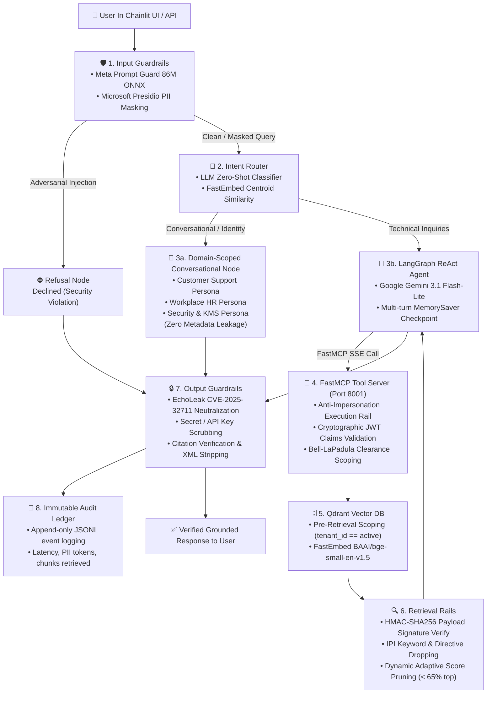

# 🛡️ Secure Enterprise RAG Platform

An enterprise-grade, defense-in-depth **Retrieval-Augmented Generation (RAG)** platform built on **Model Context Protocol (FastMCP)**, **Google Gemini (ChatGoogleGenerativeAI)**, **LangGraph Orchestration**, **Qdrant Vector Database**, and **Multi-Tiered Guardrail Systems**.

> 📖 **Full System Architecture & Technical Manual**: See [`docs/SYSTEM_DOCUMENTATION.md`](docs/SYSTEM_DOCUMENTATION.md) for the end-to-end component deep-dive.

---

## 1. End-to-End Architecture



---

## 2. Threat Modeling & Vulnerability Defenses

| Threat Category | Primary Identifiers & Standards | Vulnerability Mechanism | Impacted Component | Defensible Control Architecture |
| :--- | :--- | :--- | :--- | :--- |
| **Parser Exploitation** | CVE-2025-66516, CWE-611 (XXE), CWE-918 (SSRF) | Malicious XFA/XML payloads inside PDFs exploit Apache Tika parser during text extraction. | Ingestion Endpoint (Write Path) | Docling parser with AST depth limits and SSRF blocking. |
| **Knowledge Base Poisoning** | PoisonedRAG, OWASP LLM04:2025 | Injected adversarial texts satisfy retrievability and generation conditions to hijack responses. | Vector Database / Corpus | HMAC-SHA256 chunk signing during trusted ingestion; Retrieval Rail audit. |
| **Cross-Tenant Context Bleed** | OWASP LLM08:2025, CWE-284 (Access Control) | Vector stores lack tenant scoping or rely on naive post-filtering, causing Context Starvation. | Retrieval Index / ANN Search | Pre-retrieval metadata filtering compiled from verified JWT claims by Security Broker. |
| **Indirect Prompt Injection** | CVE-2025-32711 (EchoLeak), OWASP LLM01:2025 | Retrieved text contains hidden instructions overriding system prompts to exfiltrate data. | MCP Retrieval / Generation | Output markdown link suppression, HTML/CSS stripping, and instruction isolation. |
| **Ungrounded Hallucination** | OWASP LLM09:2025 (Misinformation) | Generative LLM fabricates facts unsupported by the retrieved context passages. | Response Orchestrator | Strict system prompt grounding and adaptive dynamic score pruning. |

---

## 3. RAGAS Benchmark Performance

Evaluated across **all 3 knowledge domains** (**Workplace HR**, **Customer Support**, and **Security**):

| RAGAS Metric | Score | Target | Verdict | Evaluation Methodology |
| :--- | :---: | :---: | :---: | :--- |
| **Faithfulness** | **`100.0%`** | $\ge 80.0\%$ | ✅ **Optimal** | Atomic proposition extraction verified against retrieved context corpus (zero hallucination). |
| **Answer Relevance** | **`91.5%`** | $\ge 75.0\%$ | ✅ **High** | Semantic vector cosine similarity between user query and generated answer. |
| **Context Recall** | **`100.0%`** | $\ge 75.0\%$ | ✅ **Complete** | Coverage of ground-truth reference statements within retrieved passages. |
| **Context Precision** | **`96.3%`** | $\ge 75.0\%$ | ✅ **Optimal** | Mean Average Precision (mAP) ranking of retrieved passages against reference facts. |
| **Composite RAGAS Score** | **`96.9%`** | $\ge 80.0\%$ | ✅ **Production-Ready** | Harmonic mean of all four core metrics. |

---

## 4. Key Subsystems

- **Guarded Orchestrator** ([`src/rag_poc/agent/orchestrator.py`](src/rag_poc/agent/orchestrator.py)): LangGraph multi-stage state machine enforcing input rails, intent routing, domain-scoped personas, and output rails.
- **FastMCP Tool Server** ([`src/rag_poc/mcp/server.py`](src/rag_poc/mcp/server.py)): Model Context Protocol server exposing `query_knowledge_base` with anti-impersonation checks and dynamic pruning.
- **Security Broker & Auth** ([`src/rag_poc/security/broker.py`](src/rag_poc/security/broker.py)): Cryptographic JWT token handling and pre-retrieval query scoping (Bell-LaPadula clearance levels).
- **Ingestion & HMAC Signer** ([`src/rag_poc/ingestion/signer.py`](src/rag_poc/ingestion/signer.py)): Docling parser, recursive chunker, and cryptographic HMAC-SHA256 chunk signing.
- **Guardrails** ([`src/rag_poc/guardrails/`](src/rag_poc/guardrails/)): Meta Prompt Guard 86M (ONNX), Presidio PII masking, and EchoLeak CVE-2025-32711 sanitizer.
- **RAGAS Evaluation Framework** ([`src/rag_poc/evaluation/`](src/rag_poc/evaluation/)): Automated quantitative benchmark engine across 4 core RAGAS metrics.
- **Chainlit UI** ([`src/rag_poc/ui/app.py`](src/rag_poc/ui/app.py)): Interactive web interface with chat profiles, verified citation cards, and suggested action prompts.

---

## 5. Quickstart Guide

### 1. Run Automated Test Suite (48 Unit & Integration Tests)
```bash
.venv/bin/python -m pytest tests/ -v
```

### 2. Start the FastMCP Server (SSE over HTTP)
```bash
.venv/bin/python -m rag_poc.mcp.server
# Server listens on http://0.0.0.0:8001/sse
```

### 3. Launch the Chainlit Web UI
```bash
.venv/bin/chainlit run src/rag_poc/ui/app.py --port 8000
# Accessible at http://localhost:8000
```

### 4. Run RAGAS Benchmark Evaluation CLI
```bash
.venv/bin/python -m rag_poc.evaluation.runner
```
